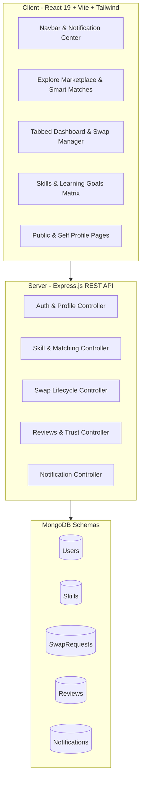

# 🔄 SkillSwap - Peer-to-Peer Knowledge Barter Platform

A modern, full-stack **MERN** (MongoDB, Express.js, React, Node.js) platform designed for bilateral, money-free knowledge exchange. Trade your skills directly with peers worldwide: teach web development to learn Spanish, or swap UI/UX design in Figma for acoustic guitar lessons.

---

## 🌟 Key Features

### 1. 🛡️ Dual-Skill Profiles & Authentication
- **Secure Authentication**: JWT-based authentication with bcrypt password hashing (password hashes stripped from all responses).
- **Dual-Skill Matrix**:
  - *Skills I Can Teach* (Offered skills with category, proficiency level, and tags).
  - *Skills I Want to Learn* (Target learning goals powering the match engine).
- **Rich Profiles**: User bios, headlines, avatars, timezones, and direct contact channels (Discord, GitHub, LinkedIn, Calendly).

### 2. ⚡ Smart Barter Matching Engine
- **Reciprocal Matching Algorithm**: Automatically identifies and ranks compatible exchange partners based on dual-skill intersection:
  - **★ Perfect Barter Match**: User A teaches what User B wants AND User B teaches what User A wants.
  - **Complementary Match**: Matches where one user's offerings satisfy the other's learning goals.
- **Dynamic Marketplace**: Filter by Category (Development, Design, Languages, Marketing, Music, etc.), Proficiency Level (Beginner to Expert), and keyword search.

### 3. 🔄 Complete Exchange Lifecycle
- **Proposal Workflow**: Propose swaps with custom notes and mutual skill selection.
- **Tabbed Dashboard**:
  - **Active Swaps**: Ongoing sessions with meeting links and coordination notes.
  - **Incoming Proposals**: Review and Accept or Decline incoming requests.
  - **Sent Proposals**: Track status (Pending, Accepted, Declined) with cancel capability.
  - **Completed History**: Archive of past successful exchanges.
- **Session Collaboration**: Built-in coordination modal to share Google Meet / Zoom / Discord room links and session agendas.

### 4. ⭐ Reputation, Trust & Reviews
- **1-5 Star Ratings & Testimonials**: Submit verified feedback upon swap completion.
- **Aggregated Trust Scores**: Automatic recalculation of member average ratings and review counts.
- **Public Profile Reviews**: Transparent community feedback displayed on profiles.

### 5. 🔔 In-App Notification Center
- Real-time notification drawer with unread badges for:
  - New swap proposals received
  - Proposal accepted / declined
  - Swap marked as completed
  - New peer review received
- "Mark all as read" capability.

### 6. 🎨 Modern, Responsive UI/UX
- Built with **React 19**, **Vite**, **Tailwind CSS**, and **Lucide Icons**.
- Interactive modals (Swap Proposal Modal, Session Notes Modal, Review Modal).
- Clean mobile-responsive drawer and desktop navigation bar.

---

## 🏗️ Architecture & Tech Stack



---

## 📡 API Endpoints

| Method | Endpoint | Description | Auth Required |
|---|---|---|---|
| `POST` | `/api/auth/register` | Register new member | No |
| `POST` | `/api/auth/login` | Login and obtain JWT | No |
| `GET` | `/api/auth/me` | Fetch authenticated user data | Yes |
| `PUT` | `/api/auth/profile` | Update profile, bio & skills needed | Yes |
| `GET` | `/api/auth/profile/:id` | View another user's public profile | No |
| `GET` | `/api/skills/all` | Query marketplace skills with filters | Optional |
| `GET` | `/api/skills/matches` | Retrieve smart barter matches for user | Yes |
| `POST` | `/api/skills/create` | List a new skill | Yes |
| `PUT` | `/api/skills/:id` | Edit owned skill | Yes |
| `DELETE` | `/api/skills/:id` | Delete owned skill | Yes |
| `POST` | `/api/requests/send` | Propose a skill swap | Yes |
| `GET` | `/api/requests/incoming` | Get incoming swap proposals | Yes |
| `GET` | `/api/requests/sent` | Get sent proposals | Yes |
| `PUT` | `/api/requests/respond/:id` | Accept or decline proposal | Yes |
| `PUT` | `/api/requests/cancel/:id` | Cancel pending proposal | Yes |
| `PUT` | `/api/requests/complete/:id` | Mark swap as completed | Yes |
| `PUT` | `/api/requests/notes/:id` | Update meeting link & session notes | Yes |
| `POST` | `/api/reviews` | Submit star rating & feedback | Yes |
| `GET` | `/api/reviews/user/:userId`| Get reviews received by a user | No |
| `GET` | `/api/notifications` | Get user notifications & unread count | Yes |
| `PUT` | `/api/notifications/read-all`| Mark all notifications read | Yes |
| `GET` | `/api/users` | Community directory search | No |

---

## 🚀 Getting Started

### Prerequisites
- Node.js (v18+)
- MongoDB (running locally or MongoDB Atlas connection string)

### 1. Clone & Install Dependencies
```bash
# Clone the repository
git clone <repo-url>
cd Skill-Swap

# Install backend dependencies
cd server
npm install

# Install frontend dependencies
cd ../client
npm install
```

### 2. Environment Configuration
Create/verify `server/.env`:
```env
MONGO_URI=mongodb://localhost:27017/skill-swap
JWT_SECRET=your_jwt_secret_key_here
PORT=5000
```

### 3. Seed Demo Data (Optional but Recommended)
Populate the database with realistic demo mentors, skills, and reciprocal barter pairs:
```bash
node server/utils/seed.js
```

### 4. Run the Application
In one terminal, start the backend:
```bash
cd server
npm start
```

In a second terminal, start the frontend:
```bash
cd client
npm run dev
```

Visit `http://localhost:5173` to explore the platform.

---

## 👥 Demo Accounts (Password: `password123`)

| Name | Role / Specialty | Email |
|---|---|---|
| **Elena Rostova** | Senior UI/UX Designer (Figma, Design Systems) | `elena@skillswap.io` |
| **Marcus Vance** | Full-Stack Engineer (Node.js, React, Docker) | `marcus@skillswap.io` |
| **Sofia Morales** | Native Spanish Coach (Conversational Spanish) | `sofia@skillswap.io` |
| **David Chen** | Growth Marketer (SEO, Content Strategy) | `david@skillswap.io` |
| **Chloe Martin** | Acoustic Guitarist & Songwriter | `chloe@skillswap.io` |
| **Aarav Patel** | Data Scientist (Python, pandas, ML) | `aarav@skillswap.io` |
